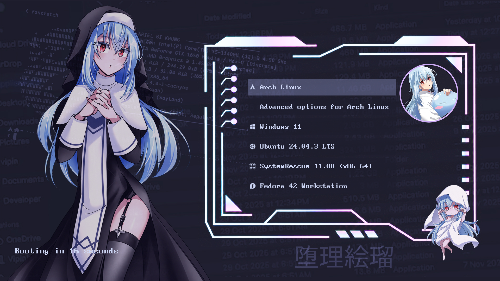

# GRUB Theme Ciel Mocha

GRUB2 theme for Arch Linux (UEFI). The background is the Ciel character inside a HUD
frame, using the Catppuccin Mocha palette and the BigBlueTerm437 Nerd Font.

<p align="center">
  
</p>

## Structure

```
src/catppuccin-mocha-grub-theme/
├── theme.txt              # theme configuration
├── background.png         # 1920x1080, PNG24, non-interlaced
├── item_c.png             # unselected option bar
├── select_c.png           # selected option bar
├── logo_ciel.png          # 226x226 PNG32 (unused — the avatar is baked into the background)
├── bigblue24.pf2          # font for menu items
├── bigblue28.pf2          # font for the label
└── icons/                 # OS icons, 36x36 PNG32
```

## Install

Copy the theme and the fonts:

```bash
sudo cp -r src/catppuccin-mocha-grub-theme /boot/grub/themes/TEN_THEME/
sudo cp src/catppuccin-mocha-grub-theme/bigblue*.pf2 /boot/grub/fonts/
```

Edit `/etc/default/grub`:

```
GRUB_THEME="/boot/grub/themes/TEN_THEME/theme.txt"
GRUB_FONTS="bigblue28 bigblue24"
GRUB_GFXMODE=1920x1080x32,auto
```

Do not set `GRUB_TERMINAL_OUTPUT`, it disables the theme.

Update the configuration:

```bash
sudo grub-mkconfig -o /boot/grub/grub.cfg
```

A `Found theme` line means the theme was picked up.

## Main configuration

| Component | Value |
|---|---|
| boot_menu | left 49%, top 27%, width 31%, height 468 |
| Option row | height 64, spacing 12, padding 12 |
| Icon | 36x36, gap to text 10 |
| Visible rows | 6, the remaining entries scroll |
| Font | BigBlueTerm437 Nerd Font Regular 24 |
| Text colour | #cdd6f4 |

The number of visible rows follows:

```
rows = (height + item_spacing - 2 * item_padding) / (item_height + item_spacing)
```

To change the number of rows, recompute `height` with this formula. For example,
`height = 468` → `(468 + 12 - 24) / 76 = 6`, while the naive `6 * 64 + 5 * 12 = 444`
only yields 5 rows.

## Notes

- The font name in `theme.txt` must match the name inside the `.pf2` file exactly
  (`strings bigblue24.pf2 | grep -A1 PFF2NAME`).
- Add the font to `GRUB_FONTS`, otherwise GRUB falls back to its default font.
- `item_pixmap_style` and `selected_item_pixmap_style` must contain `*`, for example
  `item_*.png`; a bare `item` makes GRUB fail the box pattern and drop the bars.
- Icons must be named after the entry class, for example `icons/arch.png`. GRUB uses
  the first `--class` of the entry that has a matching file; entries without an icon
  fall back to `unknown.png`.
- Text longer than the menu area is clipped — GRUB does not wrap. At `width 31%` with
  icons the text viewport is 547px, so a 24px font fits the longest entry
  ("Advanced options for Arch Linux", 496px); 26px (537px) and 30px (620px) do not.
- Percentages must be integers: a decimal such as `49.5%` silently kills the whole
  theme (blank render, no text).
- Measured against `background.png` (1920x1080): top border y 140-178, left wall
  x 786-825, glyph strip x 848-912, avatar x 1532-1758, lower ornament y 805-865.
  The window occupies y 315-742, so it overlaps none of them.
