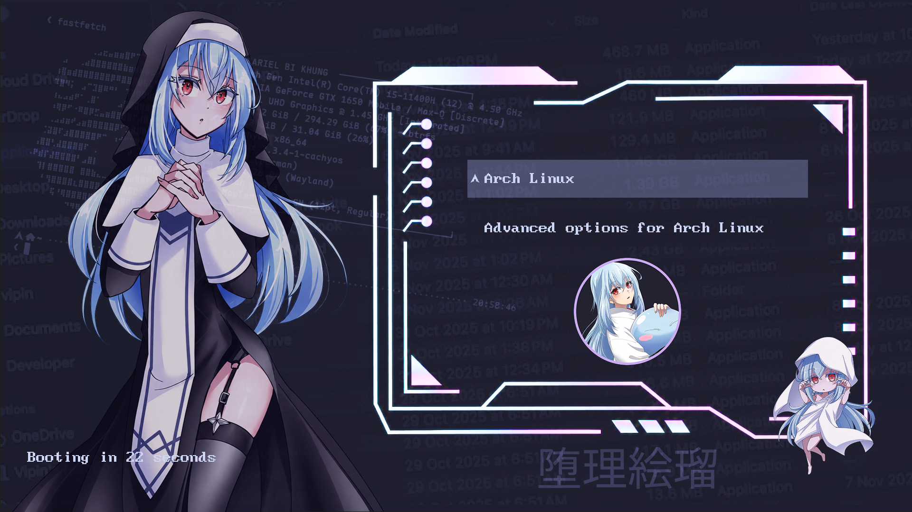

# GRUB Theme — Ciel Mocha

GRUB2 gfxmenu theme cho VM Arch Linux (virt-manager/kvm, UEFI): nền **Ciel** (nhân vật + khung HUD
+ avatar Ciel nướng sẵn ở góc trên phải), bảng màu **Catppuccin Mocha**, font **BigBlueTerm437 Nerd Font**.

## Preview



## Cấu trúc

```
src/catppuccin-mocha-grub-theme/
├── theme.txt                   # cấu hình theme
├── background.png              # 1920x1080, PNG24 8-bit, non-interlaced (nhân vật + khung HUD + avatar)
├── ciel_bg_grub_edited_3.jpg   # bản export gốc từ Figma (1922x1083 — crop +1+1 trước khi dùng)
├── item_c.png                  # thanh option chưa chọn  rgba(30,30,46,0.65)
├── select_c.png                # thanh option đang chọn  rgba(180,190,254,0.30)
├── logo_ciel.png               # 226x226 PNG32, lavender #B4BEFE (không dùng — avatar đã nướng trong nền)
├── bigblue28.pf2               # font BigBlueTerm437 Nerd Font Regular 28
├── bigblue24.pf2               # font BigBlueTerm437 Nerd Font Regular 24 (menu item)
├── font.pf2                    # font cũ của upstream (không dùng)
└── icons/                      # icon hệ điều hành cho menu entry
```

## Cài đặt

1. Copy theme vào `/boot/grub/themes/` (thay `TEN_THEME` bằng tên thư mục bạn muốn):

   ```sh
   sudo cp -r src/catppuccin-mocha-grub-theme /boot/grub/themes/TEN_THEME/
   sudo cp src/catppuccin-mocha-grub-theme/bigblue28.pf2 /boot/grub/fonts/
   sudo cp src/catppuccin-mocha-grub-theme/bigblue24.pf2 /boot/grub/fonts/
   ```

2. Sửa `/etc/default/grub`:

   ```sh
   GRUB_THEME="/boot/grub/themes/TEN_THEME/theme.txt"
   GRUB_FONTS="bigblue28 bigblue24"
   GRUB_GFXMODE=1920x1080x32,auto
   GRUB_TIMEOUT=30
   # KHÔNG đặt GRUB_TERMINAL_OUTPUT — nó vô hiệu hoá khối gfxterm + theme
   ```

3. Cập nhật cấu hình:

   ```sh
   sudo grub-mkconfig -o /boot/grub/grub.cfg
   ```

   Phải thấy `Found theme: ...`; kiểm tra lại:
   `grep -E "gfxmode|set theme|terminal_output gfxterm" /boot/grub/grub.cfg`

## Bố cục (theme.txt)

| Thành phần | Giá trị |
|---|---|
| `desktop-image` | `background.png` — nướng sẵn nhân vật + khung HUD + avatar, `stretch` |
| `boot_menu` | `left 52%`, `top 22%`, `width 27%`, `height 478` |
| item | `item_height 40`, `item_spacing 6`, `item_padding 12`, `icon_width 0`, `item_icon_space 0`, `scrollbar false` |
| số dòng hiện | 10 dòng; `rows = (H + spacing − 2*padding) / (item_height + spacing)` ⇒ 10 khi `H = 478` (`10*40 + 9*6 + 2*12`) |
| font | `BigBlueTerm437 Nerd Font Regular 18` cho `item_font`/`selected_item_font`; `…28` cho `terminal-font` + label |
| màu chữ | `#cdd6f4` (Catppuccin Mocha text) |
| nền thanh | `item_pixmap_style = "item_*.png"` / `selected_item_pixmap_style = "select_*.png"` (bắt buộc có `*` — GRUB 2.16 trả lỗi pattern thiếu `*` → box rỗng) |
| `label` | đồng hồ đếm ngược ở góc dưới-trái (`top 88%`, `left 3%`) |

Thanh option trải x 998…1516: viền trái HUD ở 786…825, dải chấm/glyph trang trí 848…912 (chữ bắt đầu
1010 nên **không đè** dải), avatar bắt đầu ≈1532 (cách 16px — không chạm).
Menu dọc: 10 thanh từ y 250 đến 702 (pitch 46). Viền trên HUD kết thúc 178, hoa văn dưới bắt đầu 805 —
cả hai đều **0 px đè**.

Cuộn dùng `make_selected_item_visible` của GRUB: khối menu **không di chuyển**, chỉ `first_shown_index`
đổi. Với 10 option, bấm ↓ tới option cuối thì option đó nằm ở hàng đáy (y 663…702); bấm ↑ thì chỉ thanh
chọn chạy lên trong khối đứng yên. Viewport chữ 482px — tên dài nhất
"Windows Boot Manager (on /dev/nvme0n1p1)" (480px @18) vừa khít, không cắt.

## Lưu ý GRUB 2.16 (đã kiểm chứng)

- `grub-mkfont` không có `--info`; tên font trong `PF2NAME` phải khớp chính xác (vd `BigBlueTerm437 Nerd Font Regular 18`).
- Pixmap style phải chứa `*` (`item_*.png`); `"item"` không có `*` → `GRUB_ERR_BAD_ARGUMENT`, thanh option không vẽ.
- `height` boot_menu điều khiển số dòng hiển thị: công thức đầy đủ
  `rows = (height + item_spacing − 2*item_padding) / (item_height + item_spacing)`.
- Chữ dài hơn viewport sẽ bị cắt im ở viền phải (không tự wrap). GRUB chừa sẵn 36px cho icon
  (`icon_width + item_icon_space`); đặt `icon_width = 0` + `item_icon_space = 0` để lấy lại 36px đó
  khi theme không vẽ icon.
- `GRUB_TERMINAL_OUTPUT` phải unset để theme render.

## Kiểm chứng

Đã boot thật trên VM (QEMU/libvirt, `-vga std`, 1920x1080) với **10 mục menu**: render 70k+ màu,
cả 10 dòng hiển thị đồng thời (pitch 46), thanh chọn cao 40px, không đè viền trên / dải chấm /
logo / hoa văn dưới (0 px mỗi vùng), scroll đúng (↓ giữ khối cố định, chọn hàng đáy y 663…702),
label đếm ngược hiển thị. Ảnh: `assets/grub-ciel-vm-10os-font18.png`.
