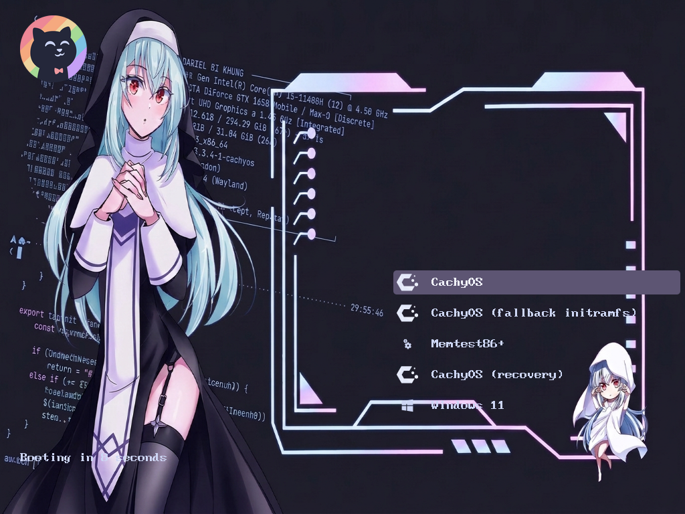

# GRUB Theme — Ciel Mocha

GRUB gfxmenu theme kết hợp nền **Ciel** (trời đêm tinh vân) với font **BigBlueTerm437 Nerd Font Mono**, dựa trên Catppuccin Mocha.

## Preview



## Cài đặt

1. Copy theme vào `/usr/share/grub/themes/`:

   ```sh
   sudo cp -r src/catppuccin-mocha-grub-theme /usr/share/grub/themes/
   ```

2. Copy font để GRUB load được (font phải nằm trong `$prefix/fonts/`):

   ```sh
   sudo cp src/catppuccin-mocha-grub-theme/bigblueterm.pf2 /boot/grub/fonts/
   ```

3. Sửa `/etc/default/grub`:

   ```sh
   GRUB_THEME="/usr/share/grub/themes/catppuccin-mocha-grub-theme/theme.txt"
   GRUB_FONTS="bigblueterm"
   GRUB_GFXMODE=1920x1080   # đổi theo độ phân giải màn hình
   ```

4. Cập nhật cấu hình:

   ```sh
   sudo grub-mkconfig -o /boot/grub/grub.cfg
   ```

## Tuỳ chỉnh

- **Layout** — sửa toạ độ trong `theme.txt`: `boot_menu` (phải-dưới), `image` (logo), `label` (đếm ngược).
- **Màu** — `item_color`, `selected_item_color`, và ảnh `select_*.png` (thanh chọn).
- **Nền** — thay `ciel_bg_grub.png`; đổi `desktop-image` trong `theme.txt`.
- **Font** — tạo `.pf2` mới: `grub-mkfont -s 16 -o <tên>.pf2 <font.ttf>`, copy vào `/boot/grub/fonts/` và đổi tên font trong `theme.txt` (đúng tên nội bộ của file `.pf2`).

## Cấu trúc

```
src/catppuccin-mocha-grub-theme/
├── theme.txt              # cấu hình theme
├── ciel_bg_grub.png       # nền (1376x768)
├── bigblueterm.pf2        # font menu
├── logo.png / select_*.png
└── icons/                 # icon hệ điều hành
```

## Ghi chú

- Nền gốc `ciel_bg_grub.png` có sẵn logo CIEL; `ciel_logo_grub.png` (ảnh đục, không có kênh alpha) không dùng trên màn hình boot.
- Font BigBlueTerm `.pf2` do `grub-mkfont` sinh từ `BigBlueTerm437NerdFontMono-Regular.ttf` (đã cài trong `/usr/share/fonts/BigBlueTerm/`).
- Đã kiểm chứng bằng boot thật trong QEMU.